# Croquetium 16

Un ordenador de 16 bits diseñado desde cero para montarlo con chips de lógica 74HC, sin microprocesador. Mezcla el ordenador de 8 bits en protoboard de Ben Eater y el ordenador Hack del curso Nand2Tetris. El objetivo es una máquina completa (CPU, vídeo, teclado y un BASIC propio) que funcione en hardware real, al estilo de una consola de fantasía como PICO-8 o TIC-80.

Ahora mismo hay:

- Un **ensamblador y emulador** en Python (`croquetium.py`).
- Un **IDE** de escritorio para escribir programas y ejecutarlos paso a paso (`croquetium_ide.py`).
- La **CPU entera en el simulador Digital**, bloque a bloque, con tests que la comparan ciclo a ciclo con el emulador (`circuitos/`).

Todavía no hay nada montado en protoboard. Vídeo, teclado de verdad y el BASIC vienen después.

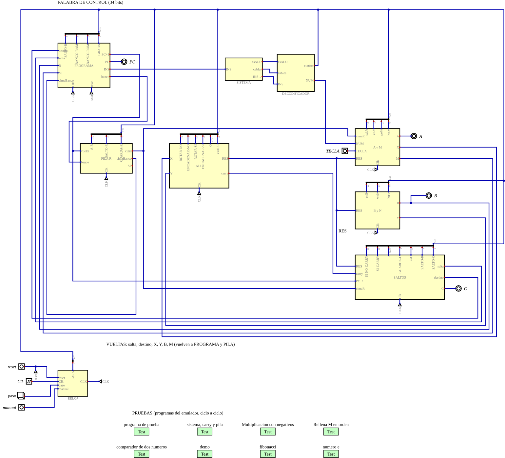

## Índice

1. [La máquina en resumen](#la-máquina-en-resumen)
2. [Formato de instrucción](#formato-de-instrucción)
3. [La ALU](#la-alu)
4. [Saltos](#saltos)
5. [Instrucciones de sistema](#instrucciones-de-sistema)
6. [El ensamblador](#el-ensamblador)
7. [El IDE y el emulador](#el-ide-y-el-emulador)
8. [Los circuitos en Digital](#los-circuitos-en-digital)
9. [Bloque a bloque](#bloque-a-bloque)
10. [La palabra de control](#la-palabra-de-control)
11. [Velocidad](#velocidad)
12. [Qué falta](#qué-falta)
13. [De dónde sale cada idea](#de-dónde-sale-cada-idea)

## La máquina en resumen

- Palabras de 16 bits. Cada instrucción ocupa una palabra y se ejecuta en **un ciclo de reloj**.
- Control **cableado**, sin microcódigo: los bits de la instrucción mandan directamente sobre el hardware. Dos ROMs pequeñas traducen la operación de la ALU y las instrucciones de sistema a señales.
- Registros:
  - **A**: dato y dirección de la RAM M. Los números escritos en el programa solo entran por A.
  - **B**: dato y dirección de la RAM N.
  - **C**: guarda a dónde se salta. No es de propósito general.
  - **PC**: contador de programa.
  - **R**: pila de retornos de 16 niveles para las funciones. No se lee directamente; se saca con `R => A`.
- Memorias:
  - **RAM M** y **RAM N**, de 64K × 16 cada una y separadas. M es la casilla a la que apunta A (`M = RAM M[A]`) y N, la casilla a la que apunta B.
  - **ROM de programa**.
  - **RAM de programas**, para cargar y ejecutar código desde un programa.
- No hay registro de flags (igual que en Hack). Los saltos miran el resultado de la ALU en la misma instrucción.
- Hay un biestable de **carry** y dos modos (**rotar** y **encadenar**) que se encienden y apagan con instrucciones de sistema.

Por qué dos RAM: así en una misma instrucción se puede operar con un dato de M y otro de N, y cada una tiene su puntero (A y B). La costumbre al programar es usar A de puntero y B de dato. A y M nunca entran juntos en una operación (un bit elige uno de los dos) y B y N tampoco.

## Formato de instrucción

```
bit:  15  14 13  12..8   7..3    2..0
      1   n  n   nnnnn   nnnnn   nnn     número: A = los 15 bits de abajo
      0   X  Y   OOOOO   DDDDD   JJJ     operación de ALU
      0   s  s   sssss   00000   000     instrucción de sistema (código = bits 8 a 14)
```

**Número (bit 15 = 1).** Los otros 15 bits van a A, así que se cargan números de 0 a 32767. Mientras tanto D y J quedan bloqueados para que los bits del número no escriban en ningún sitio ni provoquen saltos. Los negativos se sacan con `-A => A`.

**Operación de ALU (bit 15 = 0):**

| Campo | Bits | Qué hace |
|---|---|---|
| X | 14 | entrada x de la ALU: 0 = A, 1 = M |
| Y | 13 | entrada y de la ALU: 0 = B, 1 = N |
| OOOOO | 12..8 | una de las 32 operaciones |
| DDDDD | 7..3 | dónde se guarda el resultado: D0 = A, D1 = B, D2 = C, D3 = M, D4 = N (varios a la vez) |
| JJJ | 2..0 | condición de salto |

M y N se escriben en la dirección que tenían A y B **antes** de la instrucción. Si se salta, el PC carga el C de antes de la instrucción.

**Instrucción de sistema.** Con D = 0 y J = 0 una operación de ALU no tendría ningún efecto: no guarda nada y no salta. Esas 128 combinaciones se aprovechan como instrucciones de sistema. `0x0000` es NOP.

## La ALU

Funciona como la de Hack, con una etapa más. Cada entrada se puede doblar (`s`), poner a 0 (`z`) y negar (`n`). Luego se suma o se hace AND (`f`), y el resultado se puede negar (`no`).

Una ROM de 32 × 8 traduce los 5 bits de la operación a esas 8 señales (SX ZX NX SY ZY NY F NO). Las operaciones 08, 0A, 0C y 0E además dividen el resultado entre 2. Las detecta una puerta (O3 = 1, O4 = 0, O0 = 0), así que la ROM no necesita una novena señal.

| Op | Hace | Op | Hace | Op | Hace | Op | Hace |
|---|---|---|---|---|---|---|---|
| 00 | 0 | 08 | x/2 | 10 | y+1 | 18 | 2x-y |
| 01 | 1 | 09 | !y | 11 | x-1 | 19 | x-2y |
| 02 | -1 | 0A | y/2 | 12 | y-1 | 1A | 2x-2y |
| 03 | x | 0B | -x | 13 | x+y | 1B | y-x |
| 04 | 2x | 0C | (x+y)/2 | 14 | 2x+y | 1C | y-2x |
| 05 | y | 0D | -y | 15 | x+2y | 1D | 2y-x |
| 06 | 2y | 0E | (x-y)/2 | 16 | 2x+2y | 1E | x&y |
| 07 | !x | 0F | x+1 | 17 | x-y | 1F | x\|y |

Doblar no necesita sumador: es cablear cada bit una posición más a la izquierda, con un multiplexor para elegir si se dobla o no. Dividir entre 2 es lo mismo hacia la derecha.

**Carry y modos:**

- El carry se guarda en cada operación de ALU. Los números y las instrucciones de sistema no lo tocan. Qué guarda depende de la operación:
  - en sumas y restas, el bit 17 del sumador;
  - en `2x` y `2y`, el bit que se cae por la izquierda;
  - en las de `/2`, el bit que se cae por la derecha.
  - en `x+1` y `x-1` sale al revés (0 cuando se pasa), por cómo las hace la ALU con negaciones.
- **ROTAR**: al doblar o dividir, el bit que se cae vuelve a entrar por el otro lado.
- **ENCADENAR**: el sumador suma también el carry. Sirve para números de varias palabras, haciendo la misma operación en la mitad de abajo y en la de arriba.

Al dividir entre 2 entra por arriba el bit 17 del sumador (un 0 en `x/2` e `y/2`), así que `(x+y)/2` da la media aunque la suma se pase. Con negativos, las de `/2` no dan la mitad.

Ojo: cualquier operación de ALU pisa el carry, también `A => C`. El destino del salto hay que prepararlo antes de la operación que da el carry.

## Saltos

| JJJ | Se escribe | Salta si el resultado es |
|---|---|---|
| 000 | | nunca |
| 001 | `>0` | mayor que 0 |
| 010 | `=0` | 0 |
| 011 | `>=0` | mayor o igual que 0 |
| 100 | `<0` | negativo |
| 101 | `!=0` | distinto de 0 |
| 110 | `<=0` | menor o igual que 0 |
| 111 | `jmp` | siempre |

Siempre se salta a la dirección que hay en C.

## Instrucciones de sistema

Todo esto está en `sistema.json`, que leen el ensamblador, el emulador y el IDE. Cada instrucción enciende unos "cables": las salidas de la ROM de sistema. Combinar cables que ya existen es solo cambiar la ROM; algo nuevo necesita un circuito nuevo en una salida libre.

| Código | Instrucción | Qué hace |
|---|---|---|
| 1 | `PARA` | para la máquina |
| 2 | `LANZA` | salta a C dentro de la RAM de programas y guarda la vuelta en R |
| 3 | `VUELVE` | salta a C dentro de la ROM y guarda la vuelta en R |
| 4 | `RETORNA` | vuelve a donde dice R, en su banco |
| 5 | `GRABA` | copia M[A] en la RAM de programas, en la dirección B (solo ejecutando desde la ROM) |
| 6 | `PC+1 => C` | guarda en C la dirección de la siguiente línea (inicio de bucle) |
| 7 | `TECLA => A` | lee la tecla pulsada (0 si no hay) |
| 8 | `SI CARRY` | salta a C si la última operación de la ALU dio carry |
| 9 | `SI NO CARRY` | salta a C si no dio carry |
| 10 | `ROTAR` | enciende el modo rotar |
| 11 | `NO ROTAR` | lo apaga |
| 12 | `ENCADENAR` | enciende el modo encadenar |
| 13 | `NO ENCADENAR` | lo apaga |
| 14 | `R => A` | saca la cima de la pila R a A |

La RAM de programas va con la idea de que no se pueda escribir y ejecutar a la vez: `GRABA` solo funciona cuando se ejecuta desde la ROM. El reset vuelve a la ROM sin borrar la RAM.

## El ensamblador

Los programas son archivos `.cro`.

| Forma | Ejemplo | Hace |
|---|---|---|
| `@número` | `@20`, `@0x14` | A = número (0 a 32767) |
| `@variable` | `@vidas` | A = dirección de la variable (las reparte el ensamblador desde la 16) |
| `@ETIQUETA` / `(ETIQUETA)` | `@BUCLE` | A = dirección de esa línea / marca la línea |
| `OP => DEST` | `M+B => M` | calcula y guarda; varios destinos juntos: `AM` |
| `OP => DEST COND` | `M-1 => AM >0` | guarda y salta a C si se cumple |
| `OP COND` | `M-B <=0` | salta sin guardar |
| `jmp` / `NOP` | | salta siempre / no hace nada |

Comentarios con `//`. Trampas típicas:

- `@` machaca A.
- Un número que va a memoria tiene que pasar por B: `@7`, `A => B`, `@cont`, `B => M`.
- No hay desbordamiento controlado: 32767 + 1 da -32768.
- `M =0` es un salto; guardar un 0 es `0 => M`.

Ejemplo, Fibonacci en M (de `programas/fibonacci.cro`):

```
0=>M            // M[0] = 0
1=>B            // B = F(1), el primero que se guarda
PC+1=>C
A+1=>A          // <- C: avanza
B=>M            // guarda el número que ya sabemos que es bueno
A-1=>A
M=>B            // B = el anterior
A+1=>A
M+B=>B >0       // calcula el siguiente; si es positivo, vuelve a guardarlo
PARA
```

## El IDE y el emulador

Hace falta Python 3 con Tkinter (el instalador normal de Python en Windows ya lo trae).

- **IDE**: doble clic en `IDE Croquetium.bat`, o `python croquetium_ide.py`.
  - Editor con la dirección de cada línea y paso a paso con velocidad regulable.
  - Ves los registros y la instrucción desmontada por campos.
  - Las RAM M y N se recorren enteras, siguiendo a A o B o fijas en una dirección.
  - Vista tablero: los bits de varias palabras como una rejilla.
  - Pestañas con las ROMs, las instrucciones de sistema (editables) y la datasheet.
- **Línea de comandos**:

```
python croquetium.py programas/fibonacci.cro            ensambla, guarda .bin y .hex y lo ejecuta
python croquetium.py programas/fibonacci.cro --traza    enseña cada ciclo
python croquetium.py --datasheet                        escribe DATASHEET.md
python croquetium.py --rom-alu --rom-sistema            escribe las ROMs en .hex
```

El `.hex` usa el formato v2.0 raw de Logisim, que también lee Digital.

## Los circuitos en Digital

La carpeta `circuitos/` tiene la CPU dibujada en [Digital](https://github.com/hneemann/Digital), un simulador de lógica gratuito hecho en Java. Por ahora usa componentes genéricos (registros, multiplexores, sumadores), todavía no chips 74HC.

Cómo están dibujados:

- `cpu.dig` es la hoja general. Cada bloque está en su propio archivo y se abre con doble clic.
- La palabra de control (34 bits) va por arriba como un bus, y cada bloque coge sus bits con un splitter.
- El resultado de la ALU (bus RES) baja por el centro, y de él leen A y M, B y N y SALTOS.
- Lo que vuelve hacia atrás (X, Y, B, M, el salto y su destino) pasa por abajo.
- Todo va con cables de verdad. Solo CLK y reset llevan etiqueta, como en la protoboard de Ben Eater.
- Las señales van de izquierda a derecha: las entradas entran por la izquierda, el control por arriba y el reloj por abajo.

**Tests.** Cada archivo lleva los suyos. Los de `cpu.dig` cargan los programas de `programas/` (más dos de prueba) y comparan A, B, C y PC en cada ciclo con lo que da el emulador. Un cable mal puesto en cualquier camino que usen esos programas hace fallar el test. Se pasan desde el menú de tests de Digital o por consola:

```
java -cp Digital.jar CLI test -circ circuitos/cpu.dig
```

**Para verlo funcionar:** abre `cpu.dig` y arranca la simulación. Cada clic en `Clk` cambia el reloj (dos clics, un ciclo). Con `manual` a 1, el reloj avanza con el botón `paso`. Las salidas PC, A, B y C enseñan los registros.

Diferencias conocidas con el emulador: el circuito no borra TECLA al leerla, y si se saca de la pila R vacía da basura (el emulador da 0 y avisa).

## Bloque a bloque

### PROGRAMA

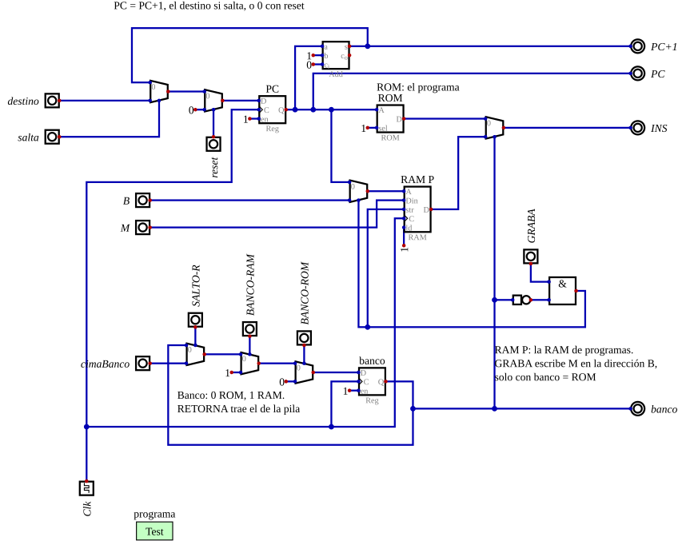

El PC elige entre tres cosas: PC+1, el destino si salta, o 0 con reset. La instrucción sale de la ROM o, si el banco vale 1, de la RAM de programas. `GRABA` escribe M en la RAM de programas, en la dirección B, y solo deja hacerlo con el banco en ROM.

El banco cambia de tres formas: `LANZA` lo pone en RAM, `VUELVE` lo pone en ROM y `RETORNA` recupera el que se guardó en la pila.

### SISTEMA

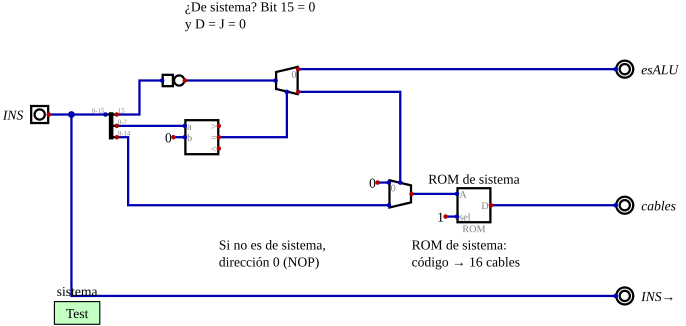

Decide si la instrucción es de sistema: bit 15 a 0 y D = J = 0. Si lo es, su código (bits 8 a 14) va a la ROM de sistema, que saca los 16 cables. Si no, la ROM lee la dirección 0, que tiene todos los cables a 0. También saca `esALU`, que indica que es una operación de ALU de verdad y es lo que deja guardar el carry. La instrucción sigue tal cual hacia el decodificador.

### DECODIFICADOR

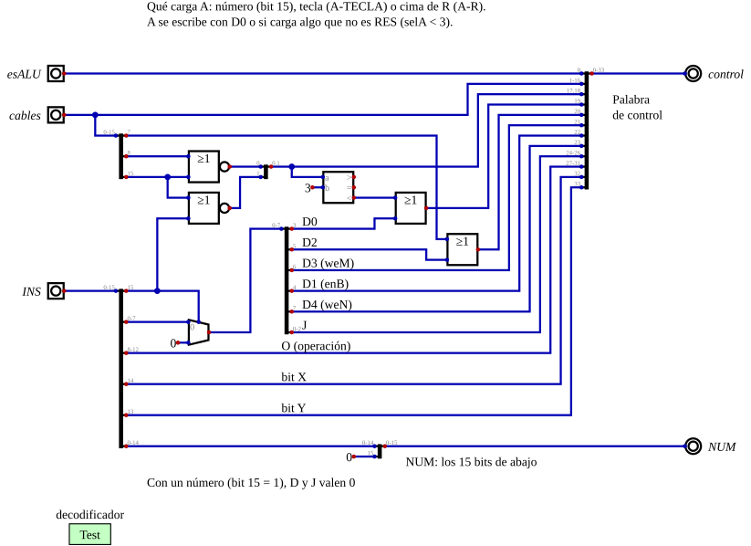

Corta la instrucción en campos y arma la palabra de control. Con un número (bit 15 = 1) bloquea D y J. Además decide:

- **Qué carga A** (selA): 0 la cima de R, 1 el número, 2 la tecla, 3 el resultado de la ALU.
- **Si se escribe A**: con D0, o si carga cualquier cosa que no sea el resultado.
- **Si se escribe C**: con D2, o con `PC+1 => C`.

### ALU

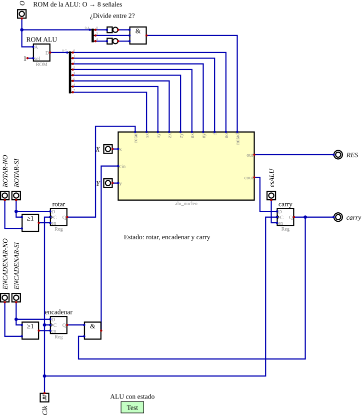

La ROM de la ALU traduce la operación a las 8 señales, y una puerta detecta las de dividir entre 2. Abajo están los tres biestables de estado: carry, rotar y encadenar. El sumador recibe el carry solo con el modo encadenar encendido.

Por dentro, el núcleo (`alu_nucleo.dig`) usa dos veces el mismo camino de entrada (`camino.dig`), uno para x y otro para y. Cada camino lleva los 16 bits de su entrada: doblar, poner a 0 y negar. Después vienen la suma o el AND, la negación final y el desplazamiento a la derecha para las de /2.

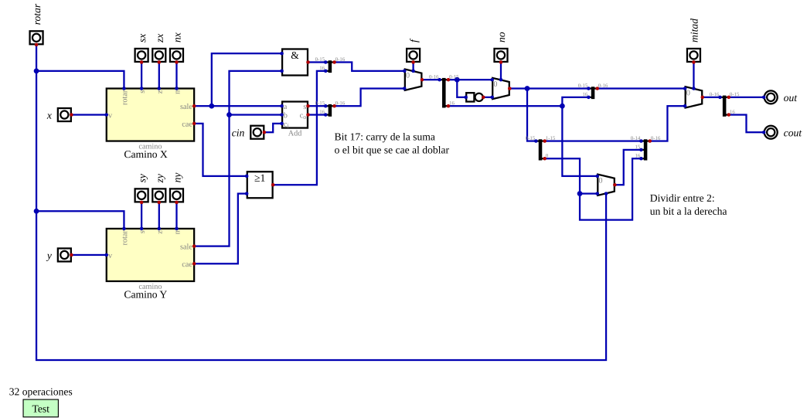

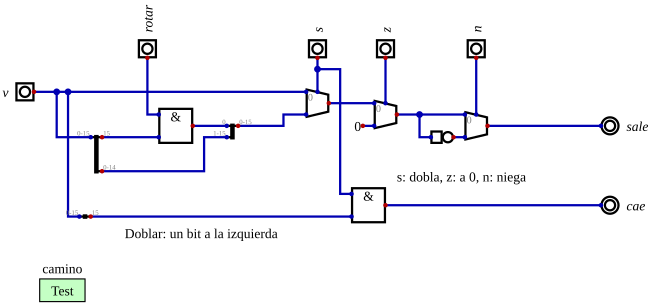

Un detalle: el bit que se cae al doblar va al carry. Las operaciones que no suman (f = 0) nunca doblan las dos entradas a la vez, así que basta un OR de los dos bits para saber cuál se cayó.

### PILA R

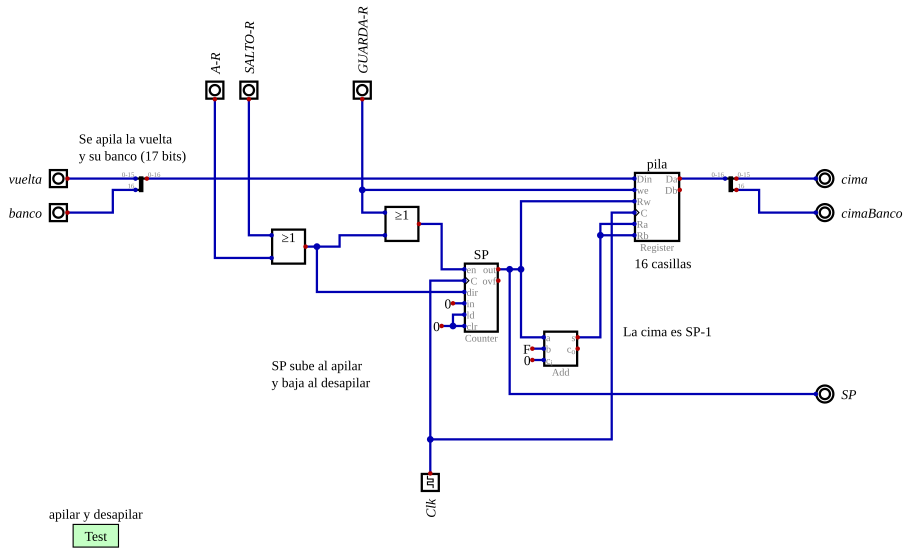

Es una memoria de 16 palabras con un contador que apunta a la cima (SP).

- `LANZA` y `VUELVE` apilan PC+1 y el banco.
- `RETORNA` desapila y devuelve los dos a PROGRAMA.
- `R => A` desapila hacia A.

Si se apilan más de 16, se pisa la más vieja.

### A y M

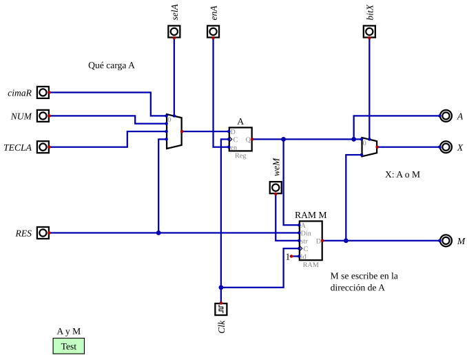

Contiene el registro A, la RAM M (con A como dirección) y el multiplexor X, que elige entre A y M según el bit X de la instrucción. A carga lo que diga selA. M se escribe con el resultado de la ALU.

### B y N

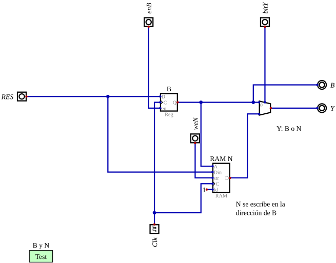

Igual que A y M, pero más sencillo: B solo carga el resultado de la ALU. Y es B o N según el bit Y.

### SALTOS

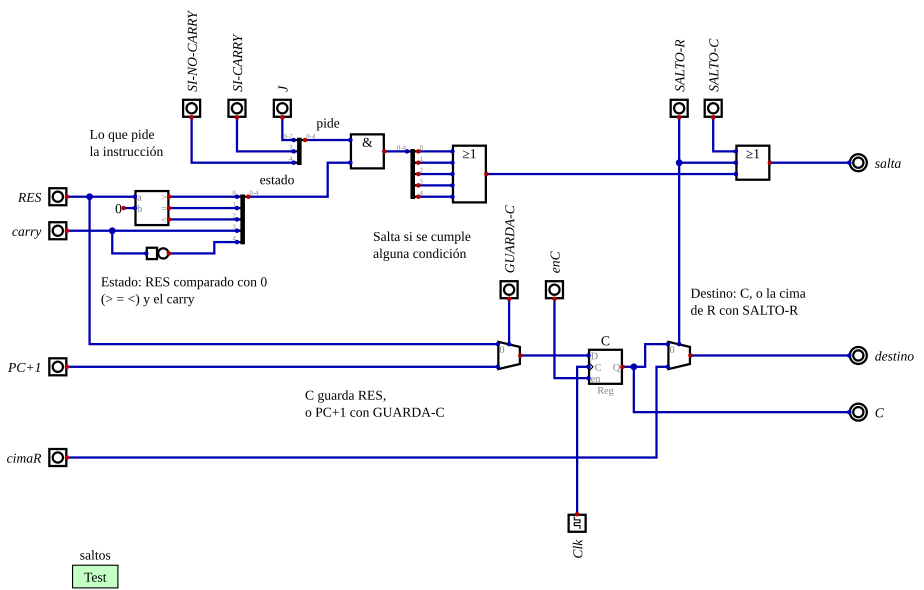

Contiene el registro C y la lógica de salto.

Primero un comparador saca los flags del resultado: P (mayor que 0), Z (cero) y N (negativo). Unas AND los cruzan con lo que pide la instrucción (J, `SI CARRY` o `SI NO CARRY`), y si alguno coincide, se salta.

Además:

- `SALTO-C` salta siempre.
- `SALTO-R` (`RETORNA`) salta a la cima de la pila en vez de a C.
- C carga el resultado de la ALU, o PC+1 con `PC+1 => C`.

### RELOJ

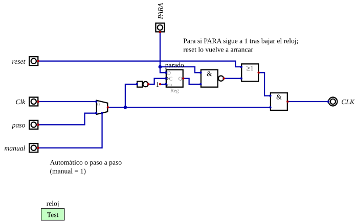

Va como en Ben Eater: automático (`Clk`) o paso a paso (botón `paso`), según el interruptor `manual`. `PARA` lo detiene, como el HLT de Ben Eater.

`PARA` no corta el reloj directamente: se guarda en un biestable en el flanco de bajada, y el reloj solo se para si ese biestable y `PARA` siguen a 1. Así, un pico de `PARA` mientras cambia la instrucción no puede colar un flanco de más; en la simulación eso pasaba y la máquina se paraba un ciclo antes. Reset lo vuelve a arrancar.

En protoboard serían tres 555 y unas puertas.

## La palabra de control

Son 34 bits que salen del decodificador y van a todos los bloques:

| Bits | Señal |
|---|---|
| 0 | esALU |
| 1 | PARA |
| 2 | SALTO_C |
| 3 | SALTO_R |
| 4 | GUARDA_R |
| 5 | BANCO_RAM |
| 6 | BANCO_ROM |
| 7 | GRABA_PROG |
| 8 | GUARDA_C |
| 9 | A_TECLA |
| 10 | SI_CARRY |
| 11 | SI_NO_CARRY |
| 12 | ROTAR_SI |
| 13 | ROTAR_NO |
| 14 | ENCADENAR_SI |
| 15 | ENCADENAR_NO |
| 16 | A_R |
| 17-18 | selA |
| 19 | enA (se escribe A) |
| 20 | enC |
| 21 | weM (se escribe M) |
| 22 | enB |
| 23 | weN |
| 24-26 | J |
| 27-31 | O (operación) |
| 32 | bit X |
| 33 | bit Y |

Los bits 1 a 16 son los cables de la ROM de sistema, en el orden de `sistema.json`.

## Velocidad

Son cálculos sobre el papel; no hay nada medido todavía. En cada ciclo la señal tiene que atravesar, una detrás de otra:

1. la ROM de programa;
2. la ROM de la ALU;
3. la ALU (con un sumador de 4 chips en cadena);
4. la lógica de salto;
5. la llegada al PC.

Las dos ROMs son lo más lento: unos 150 ns cada una con una 28C256, frente a unos 10-20 ns de una puerta. Sumando todo sale un ciclo de unos 600 ns, así que con margen debería ir a **1 MHz o algo más**, como un Commodore 64 o un Apple II.

Si algún día hace falta más velocidad, hay tres opciones:

- **ROMs más rápidas.** Por ejemplo una SST39SF010A, de 70 ns.
- **Sacar la ROM de la ALU del camino.** Se graban sus 8 señales ya traducidas junto a cada instrucción, en una ROM de programa más ancha.
- **Ejecutar desde la RAM de programas** si es una SRAM rápida.

## Qué falta

- Comparar también M, N y el carry ciclo a ciclo, y probar con programas aleatorios.
- Decidir si los movimientos (`A => C`, `M => B`) dejan de pisar el carry.
- Pasar los bloques de Digital a chips 74HC reales (Digital tiene librería 74xx), con los mismos tests.
- Contar chips y medir la ruta crítica con los datos de cada chip.
- Montar la CPU mínima en protoboard.
- Salida de vídeo (pantalla mapeada en memoria), teclado y el BASIC (Croquetium BASIC).

## De dónde sale cada idea

- [Ben Eater, ordenador de 8 bits en protoboard](https://eater.net/8bit): montaje por módulos con chips 74xx, reloj con 555 y la instrucción HLT.
- [Nand2Tetris](https://www.nand2tetris.org/): la ALU de Hack con sus señales zx, nx, zy, ny, f, no; el registro A como puntero a M; los saltos sin registro de flags.
- [Digital, de Helmut Neemann](https://github.com/hneemann/Digital): el simulador de los circuitos.

Hecho por Javier Meneses Perez.
